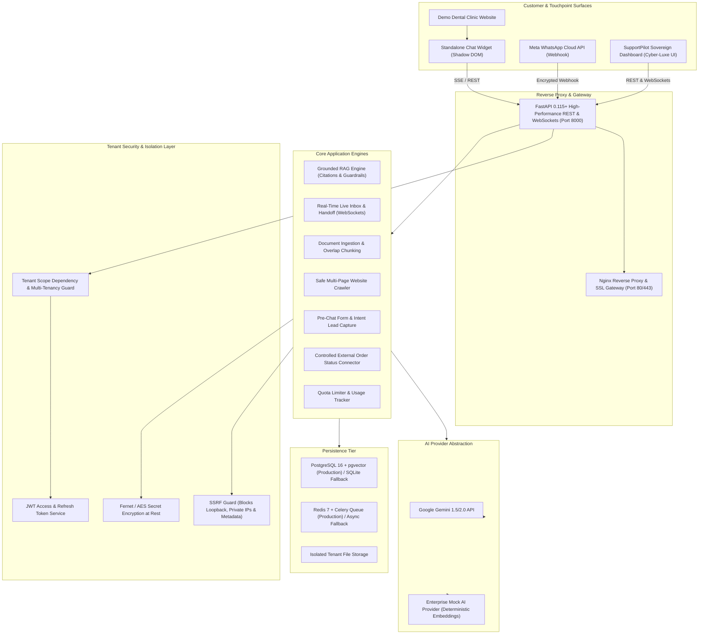

# SupportPilot 🚀
### Production-Ready Multi-Tenant AI Customer Support SaaS Platform

SupportPilot is an enterprise-grade multi-tenant SaaS platform that enables businesses to deploy autonomous, grounded AI customer-support concierges trained on their verified knowledge bases. SupportPilot integrates dual-channel engagement across embeddable website widgets and the official Meta WhatsApp Cloud API, accompanied by a real-time human agent Live Inbox, SSRF-protected website crawlers, document vectorization (PDF, DOCX, TXT, CSV, Markdown), lead capture, and the MRRAW Bank / Bank Asia ZEN **Dark Neo-Vault & Cyber-Luxe** visual identity.

---

## 1. System Architecture Diagram



---

## 2. Key Features

- **Multi-Tenant Architecture**: Strict database-level tenant isolation across 20+ entities. Tenant A can never read or mutate Tenant B's bots, documents, conversations, leads, or API keys.
- **Grounded RAG Engine**: Zero hallucinations. Answers are strictly bounded by approved business information. If ungrounded, returns configured fallback and records query in `Unanswered Questions`.
- **Bilingual & Multi-Language Support**: Native support for **English** and **Bengali (বাংলা)**.
- **Multi-Format Document Ingestion**: Ingests and overlapping-chunks PDF, DOCX, TXT, CSV, and Markdown files with background vector embedding generation.
- **SSRF-Protected Website Crawler**: Imports website content while actively blocking access to internal IPs (`127.0.0.1`, `10.0.0.0/8`, `192.168.0.0/16`, `172.16.0.0/12`), loopback, and cloud metadata (`169.254.169.254`).
- **Official Meta WhatsApp Cloud API**: Webhook verification handshake, HMAC-SHA256 signature validation, and bi-directional message dispatch.
- **Real-Time Live Inbox**: WebSockets connection (`/api/v1/ws/live-inbox`) allowing human agents to accept handoffs, chat with customers in real-time, and route replies directly back to WhatsApp or the widget.
- **Single-Tag Embeddable Widget**: Lightweight, framework-agnostic JavaScript widget with Shadow DOM style isolation, streaming SSE responses, typing indicators, and suggested questions.
- **Order Status Lookup Connector**: Secure server-side function calling allowing the chatbot to look up order IDs from external business APIs.
- **Passkey On-Screen Keypad Login**: High-security 4-digit PIN authentication panel (`3400` default instant access) inspired by the MRRAW Bank / Bank Asia ZEN Cyber-Luxe design language.
- **SaaS Subscription & Quota Enforcement**: Basic, Pro, and Business plans with monthly message limits, token metrics, and Stripe billing abstraction.
- **Super Admin Platform Control**: Dedicated platform administration console to inspect platform usage, monitor AI costs, and activate/suspend workspaces.

---

## 3. Technology Stack

- **Backend**: Python 3.11+, FastAPI, SQLAlchemy 2, Pydantic v2, Alembic, SSE-Starlette, WebSockets
- **Database**: PostgreSQL with pgvector (production) / SQLite with vector cosine fallback (local zero-dependency dev)
- **Background Workers**: Redis, Celery, and async worker task queue
- **AI Providers**: Google Gemini API (`gemini-1.5-flash`, `text-embedding-004`) + High-Fidelity Mock AI Provider
- **Frontend Dashboard**: React 18, Vite, TypeScript, Tailwind CSS, Lucide Icons, Recharts
- **Chat Widget**: Standalone vanilla JavaScript bundle with Shadow DOM encapsulation
- **Deployment**: Docker, Docker Compose, Nginx Reverse Proxy with SSL readiness

---

## 4. Repository Structure

```
supportpilot/
│
├── backend/
│   ├── app/
│   │   ├── api/v1/          # REST & WebSocket Endpoints
│   │   ├── core/            # Config, DB, Security, Auth Dependencies
│   │   ├── models/          # 20+ Multi-Tenant SQLAlchemy Models
│   │   ├── schemas/         # Pydantic v2 Input/Output Schemas
│   │   ├── ai/              # AI Provider Abstraction (Gemini & Mock)
│   │   ├── rag/             # Parsers, Chunker, SSRF-safe Crawler, Retriever, Engine
│   │   ├── workers/         # Ingestion & Web Scraping Workers
│   │   ├── integrations/    # WhatsApp Cloud API, Order Lookup, SMTP Email
│   │   └── utils/           # SSRF Validator, Encryption, Seed Utility
│   ├── alembic/             # Database Migration Scripts
│   ├── tests/               # Pytest Suite (Tenant Isolation, Auth, RAG, WhatsApp)
│   ├── Dockerfile
│   └── requirements.txt
│
├── dashboard/               # Cyber-Luxe Sovereign Workstation Admin Dashboard
│   ├── src/
│   │   ├── components/      # Overview, Bots, Knowledge, Live Inbox, etc.
│   │   ├── services/        # Typed API Client
│   │   ├── App.tsx          # macOS-Style Window Frame Shell
│   │   └── index.css        # Atmospheric Radial Gradients & Color Tokens
│   ├── Dockerfile
│   └── package.json
│
├── widget/
│   ├── src/widget.js        # Standalone Shadow DOM Embeddable Script
│   ├── dist/widget.js       # Production Build Artifact
│   └── demo.html            # Demo Dental Clinic Public Website
│
├── infrastructure/
│   └── nginx/nginx.conf     # Production Nginx Gateway Reverse Proxy
│
├── scripts/
│   └── evaluate_rag.py      # 20-Question RAG Precision Benchmark Evaluator
│
├── docs/                    # Architecture, Database Schema, and Benchmark Reports
├── docker-compose.yml       # Production Compose Multi-Container Definition
├── .env.example             # Complete Documented Environment Variables
└── README.md
```

---

## 5. Quickstart & Local Execution

### Prerequisites
- Python 3.11+
- Node.js 18+ and npm
- (Optional) Docker & Docker Compose

### Step 1: Environment Setup
Clone the repository and copy `.env.example`:
```bash
cp .env.example .env
```

### Step 2: Run Backend & Seed Database
In the root or `backend` folder:
```bash
# Install backend dependencies
pip install -r backend/requirements.txt

# Run initial migration and seed Demo Dental Clinic data
python backend/app/utils/seed.py

# Start the FastAPI server (Port 8000)
uvicorn app.main:app --host 0.0.0.0 --port 8000 --app-dir backend
```
The backend initializes database tables, seeds the demo dental clinic workspace, and starts on `http://localhost:8000`.

### Step 3: Run Frontend Dashboard
In a separate terminal:
```bash
cd dashboard
npm install
npm run dev
```
Open your browser at `http://localhost:3000`.

---

## 6. Demo Account & Immediate Verification

The development environment is pre-seeded with realistic data for **Demo Dental Clinic**:

### Instant Passkey Login (Cyber-Luxe PIN)
- **URL**: `http://localhost:3000`
- **Demo Passkey PIN**: **`3400`** (Enter on on-screen keypad or keyboard)

### Email / Password Login
- **Demo Workspace Owner**:
  - Email: `demo@supportpilot.ai`
  - Password: `password123`
- **Platform Super Administrator**:
  - Email: `superadmin@supportpilot.ai`
  - Password: `adminpassword123`

### Demo Dental Clinic Website & Widget
- **URL**: `http://localhost:8000/uploads/demo.html`
- Features the live embeddable widget connected to the Demo Dental Clinic knowledge base.

---

## 7. AI Provider Configuration (Google Gemini)

To switch from Mock mode to live Google Gemini:
1. Obtain an API key from Google AI Studio.
2. Update your `.env`:
```env
AI_PROVIDER=gemini
GEMINI_API_KEY=your_actual_gemini_api_key_here
GEMINI_CHAT_MODEL=gemini-1.5-flash
GEMINI_EMBEDDING_MODEL=text-embedding-004
```
3. Restart the backend. The provider factory automatically transitions from mock mode to live Gemini LLM inference and embeddings.

---

## 8. Meta WhatsApp Cloud API Configuration

1. In your Meta Developer Console, create a WhatsApp App and configure a WhatsApp Business Account.
2. In the SupportPilot Dashboard under **Channels & Meta**:
   - Enter your **Phone Number ID**
   - Enter your **Permanent System User Access Token** (encrypted at rest with 256-bit AES)
   - Set your **Webhook Verify Token** (e.g. `supportpilot_demo_verify_token`)
3. In Meta Dashboard, configure the Webhook URL:
   - `https://your-domain.com/api/v1/whatsapp/webhook`
   - Verify token: matching your configured token.
4. Test without Meta credentials: Use the built-in **WhatsApp Simulator** in the Channels tab to simulate incoming WhatsApp messages.

---

## 9. Running Tests & RAG Evaluation Benchmark

### Automated Backend Tests
Run the 10-test automated suite (including multi-tenant isolation, WhatsApp webhooks, and grounded RAG):
```bash
# Windows PowerShell
$env:PYTHONPATH="backend"; python -m pytest backend/tests -v

# Linux / macOS
PYTHONPATH=backend python -m pytest backend/tests -v
```

### RAG Precision Benchmark
Run the 20-question benchmark measuring retrieval recall, answer correctness, and fallback accuracy:
```bash
# Windows PowerShell
$env:PYTHONPATH="backend"; python scripts/evaluate_rag.py

# Linux / macOS
PYTHONPATH=backend python scripts/evaluate_rag.py
```
The output report is automatically generated at `docs/RAG_EVALUATION.md`.

---

## 10. Docker Compose Production Deployment

To start all 5 containers (PostgreSQL + pgvector, Redis, Backend, Dashboard, and Nginx Gateway):
```bash
docker compose up -d --build
```
- Gateway: `http://localhost` (Port 80)
- Dashboard: `http://localhost:3000`
- REST API: `http://localhost:8000`
