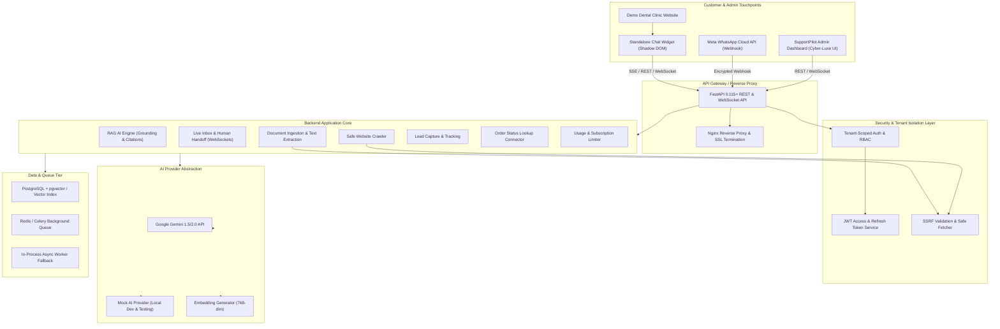

# SupportPilot: Production-Ready Multi-Tenant AI Customer Support SaaS

## System Architecture & Technical Specification

### 1. Architectural Overview

SupportPilot is designed with strict multi-tenant isolation, enterprise-grade AI retrieval-augmented generation (RAG), and dual-channel customer engagement (Website Chat Widget & WhatsApp Business Cloud API).

### 2. Multi-Tenant Isolation Model

Every tenant record in the database is strictly bound to a `tenant_id` foreign key. The backend utilizes FastAPI dependency injection (`get_current_tenant`) to extract the tenant context from the validated JWT token or public bot API key. No query executes across tenant boundaries without explicit Super Admin role verification.

### 3. Visual Identity & Color Grading Specification

In accordance with the MRRAW Bank / Bank Asia ZEN Cyber-Luxe design language:

- **Base Canvas**: Deep Void Black (`#020d0c`) with dual radial ambient light cones (Teal 30% and Amber 16%) over a 120-degree linear dark gradient.
- **Surface Elevation**: Frosted Slate Card Surface (`#07152b` with 90% opacity, `backdrop-blur-2xl`, and `1px solid rgba(255, 255, 255, 0.10)`).
- **Accents**: Primary Teal (`#087b6d` to `#169889`), Cyber Cyan (`#38bdf8`), Flame Orange (`#ff6819`), and Gold (`#f3dc64`).
- **macOS Window Frame**: Desktop workstation viewport with animated pulsing red, amber, and green window dots (`#ff675d`, `#ffbd45`, `#31c94d`).
- **Passkey On-Screen Keypad**: 3x4 tactile PIN grid with default demo passkey `3400`.
